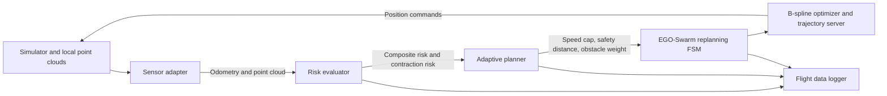

# Core implementation and ROS 2 environment

The source tree is a ROS 2 workspace `src` directory. The paper's online risk and adaptation modules are under `my_navigation/`. `planner/` provides EGO-Swarm local replanning and B-spline trajectory optimization. `uav_simulator/` provides the simulation, sensing, map, and SO(3) control components.

## Architecture



| Source | Function |
| --- | --- |
| [sensor_adapter.cpp](my_navigation/sensor_adapter/src/sensor_adapter.cpp) | Normalizes odometry and point-cloud inputs to `/uav/odom` and `/uav/pointcloud`. |
| [risk_evaluator.cpp](my_navigation/risk_evaluator/src/risk_evaluator.cpp) | Voxelizes the forward region, derives global and local contraction from slice openness, computes the braking channel, and publishes the weighted risk. |
| [adaptive_planner.cpp](my_navigation/adaptive_planner/src/adaptive_planner.cpp) | Applies EMA and limits changes in the accepted risk. Maps the smoothed values to the speed cap, safety distance, and obstacle weight. |
| [ego_replan_fsm.cpp](planner/plan_manage/src/ego_replan_fsm.cpp) | Subscribes to `/adaptive/max_velocity`, `/adaptive/safe_distance`, and `/adaptive/collision_weight`. Applies them to the replanning stack. |
| [bspline_optimizer.cpp](planner/bspline_opt/src/bspline_optimizer.cpp) | Optimizes local B-spline trajectories under the planner settings. |
| [data_logger.py](my_navigation/data_logger/data_logger.py) | Collects experimental time series and planning events. |
| [risk_data_collect.launch.py](planner/plan_manage/launch/risk_data_collect.launch.py) | Connects the simulator, adapter, evaluator, and adaptive layer for the general collection workflow. |

The proposed braking demand is `v * tau + v^2 / (2 * a_b)`. `braking/use_d0` restores the static offset for Legacy. `gate/enabled` controls the contraction gate. The two gates scale the increments to the safety distance and obstacle weight. The speed cap uses the smoothed composite risk. Use the node parameter snapshots for the exact configuration of a plotted experiment.

## Build and general launch

The inspected WSL environment runs Ubuntu 22.04.5 LTS, Python 3.10.12, GCC 11.4.0, CMake 3.22.1, ROS 2 Humble, and `rmw_cyclonedds_cpp`. Simulation uses the ROS system Python. Use the separate Python environment in the [root README](../README.md) for offline plots. Configure the ROS apt repository for Ubuntu Jammy using the [ROS 2 Humble installation source](https://github.com/ros2/ros2_documentation/blob/humble/source/Installation/Ubuntu-Install-Debs.rst).

```bash
sudo apt update
sudo apt install build-essential cmake python3-rosdep python3-colcon-common-extensions \
  ros-humble-desktop ros-humble-rmw-cyclonedds-cpp ros-humble-pcl-ros \
  ros-humble-pcl-conversions ros-humble-cv-bridge ros-humble-rosbag2-storage-default-plugins \
  libeigen3-dev libboost-all-dev libopencv-dev libpcl-dev libarmadillo-dev \
  python3-numpy python3-scipy python3-yaml python3-pandas python3-matplotlib
source /opt/ros/humble/setup.bash
# Run from the package root containing src/.
rosdep update
rosdep install --from-paths src --ignore-src -r -y
colcon build --symlink-install --cmake-args -DCMAKE_BUILD_TYPE=Release
source install/setup.bash
export RMW_IMPLEMENTATION=rmw_cyclonedds_cpp
ros2 launch ego_planner risk_data_collect.launch.py
```

Initialize `rosdep` with `sudo rosdep init` on a fresh machine if it has no sources yet. The generic collection launch is the quickest entry point for inspecting the ROS topic chain. For matched runs, use the archived experiment settings linked from the corresponding section README. A new run can have different scheduling and timing.

## Table 1 notation

| Symbol | Meaning | Unit or range |
| --- | --- | --- |
| ρ_occ | Region-of-interest voxel occupancy | [0, 1] |
| F_i | Cross-sectional openness of slice i | [0, 1] |
| C_global | Overall contraction component | [0, 1] |
| G_local | Maximum local contraction gradient | [0, 1] |
| R_c | Channel contraction risk | [0, 1] |
| d_min | Distance to the nearest obstacle | m |
| d_brake | Speed-dependent braking demand | m |
| R_b | Dynamic braking risk | [0, 1] |
| R_g | Combined geometric–kinematic risk | [0, 1] |
| R̄ | EMA-smoothed combined risk | [0, 1] |
| H_d, H_λ | Contraction gates for distance and obstacle weight | [0, 1] |
| v_max | Adaptive maximum velocity | m/s |
| d_safe | Adaptive safety distance | m |
| λ_obs | Adaptive obstacle cost weight | Dimensionless |
| w_p, w_b, w_c | Risk fusion weights | [0, 1] |
| η | Global-to-local contraction fusion weight | [0, 1] |
| λ | EMA smoothing coefficient | [0, 1] |
| k_c | Obstacle-weight gating gain | [0, 1] |
| γ | Obstacle penalty mapping exponent | Dimensionless |
| b(t) | Common braking demand for evaluation | m |
| m_c, m_b | Center and body braking margins | m |
| φ_c, φ_b | Negative-margin time fractions | [0, 1], reported as % |
| D_b | Cumulative body-margin deficit | m·s |
| E_RMSE | Time-weighted trajectory tracking RMSE | m |
| β | Body-margin exposure budget | [0, 1], reported as % |
